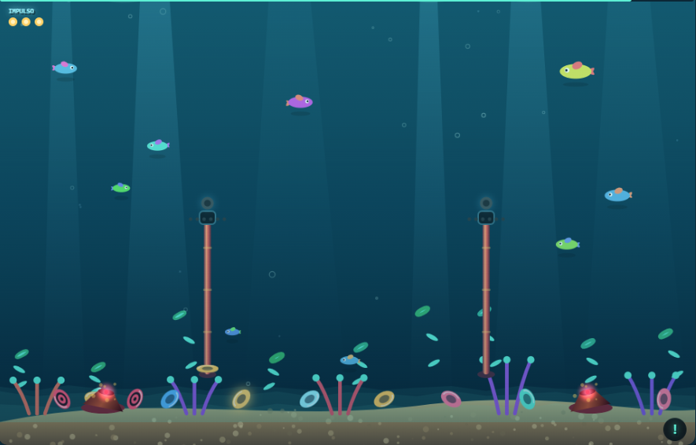

# AQUARING // MAREA VIVA

Arcade de pesca de anillos en un acuario retro. Un solo archivo HTML autocontenido
(~31,5 KB, límite duro 32 KB): canvas 2D procedural, música chiptune y SFX con Web Audio,
sin assets externos ni peticiones de red en runtime.



## Concepto y cómo se juega

Inclinas el marco completo (marco, HUD y agua giran como una pieza) para que los anillos
que aparecen sobre la grava caigan en los dos pilares y se apilen. Los monstruos intentan
robarlos o comérselos; los volcanes los espantan con impulsos. Cada 3 anillos apilados (o
combo de 8) ambas testas cargan su protector eléctrico completo: 6 luces por torre, en
FÁCIL y en DIFICIL.

- **Menú**: `A`/`←` = FÁCIL (por defecto), `D`/`→` = DIFICIL; `Space`/`Enter`/toque empieza.
- **Partida**: `←`/`→` inclinan; `A`/`D` erupcionan los volcanes (solo oleada 1, mantén para
  cargar y suelta); `P`/`Esc` pausa; `M` silencia; `R` reinicia al terminar.
- **Reglas clave**: las bombas no cuentan para completar la oleada y explotan a los 2,4 s
  (−3 s, expulsan anillos, reinician combo); los dorados valen 500; el temporizador es por
  oleada; las oleadas son infinitas y rotan paleta de agua, decoración, enemigos y música.
- **Objetivo**: apilar todos los anillos reales (`FALTAN N` en el HUD) antes de que el
  tiempo llegue a 0; al final, rango S/A/B/C y récord en `localStorage`.

## Arquitectura

Un único `index.html` generado, nunca editado a mano:

```
index.template.html ─┐
                     ├─► esbuild (bundle IIFE, ES2020) ─► terser (minify + mangle) ─► index.html
src/main.js ─────────┘                                    (CSS inline incluido)
```

Decisiones de diseño:

- **Autocontenido**: todo (HTML, CSS, JS, gráficos) dentro de un archivo; los gráficos son
  canvas 2D procedural.
- **Mangle de propiedades**: terser renombra las claves internas de los objetos del juego.
  La interfaz externa es `window.__AQ` con ganchos tipo función; leer propiedades directas
  (`p.x`, `m.mode`) no funciona. Ver `test_agent/README.md`.
- **ES único**: tabla de textos plana en `state.js`, indexada por posición; sin i18n.
- **Bucle**: `requestAnimationFrame` con `dt` limitado a 0,05 s; escenas `menu`, `play`
  (oleadas), `over`; overlays de controles, pausa y ayuda.

### Archivos

| Ruta | Para qué sirve |
| --- | --- |
| `index.html` | build final autocontenido (generado) |
| `index.template.html` | carcasa: canvas `#c`, capas CRT, laterales arcade |
| `src/config.js` | constantes, paleta, atajos matemáticos |
| `src/state.js` | estado global, textos ES, layout responsive, decoración, oleadas, monstruos, testas, volcanes |
| `src/game.js` | entrada, física de anillos, colisiones, apilado, IA de monstruos, zapes, erupciones |
| `src/audio.js` | música chiptune frigia y SFX (Web Audio) |
| `src/render.js` | todo el dibujo: rayos de luz, cáusticas, tanque, HUD, menú, ventanas |
| `src/main.js` | arranque, bucle RAF, hook `window.__AQ` |
| `tools/` | build y tests headless en Node (`smoke`, `camtest`, `ringtest`, `coiltest`, `wavetest`, `lefttest`, `volctest`, capturas CDP) |
| `test_agent/` | E2E en Chrome real con Playwright (`auto_test.js`, `realtime.test.js`) |
| `AGENT.md` | historial de cambios y decisiones del proyecto |
| `port.png` | captura de presentación del juego |

No se versionan: `shots/`, `.playwright-mcp/`, `node_modules/`, logs, heapsnapshots,
`game_desinger_v2/` (copia antigua congelada) y `docs/`.

## Generar el build

```sh
npm install
npm run build     # regenera index.html; código 1 si pasa de 32 400 B
npm run size      # solo verifica el tamaño del index.html actual
```

El build imprime el total y la línea `meta 32 000 B ok` (objetivo informativo; el tope
duro acordado es 32 400 B y la rebanada física 32 768 B). Para jugar, abre `index.html`
en el navegador; no hace falta servidor.

## Verificar

```sh
node tools/smoke.mjs        # mecánicas básicas y ventana de controles (Node puro)
node tools/coiltest.mjs     # 6 cargas por torre en ambas dificultades (y --hard)
node tools/ringtest.mjs     # composición de oleadas 1-3 (y --hard)
node tools/wavetest.mjs     # fin de oleada 1 -> 2 (y --hard)
node tools/volctest.mjs     # impulsos A/D y cangrejo asustado en DIFICIL
node tools/camtest.mjs      # dos pilares, A/D, marco entero rotando
node tools/lefttest.mjs     # FALTAN solo cuenta anillos reales
node test_agent/auto_test.js      # E2E Chrome: menú -> oleada 5 en ambas dificultades
node test_agent/realtime.test.js  # E2E Chrome: controles reales, inclinación, A/D
```

## Usar el MCP de Playwright para agents

El juego expone `window.__AQ` precisamente para que un agent lo verifique en vivo.

1. Sirve el build (algunos flujos de Playwright bloquean `file://`):
   `python -m http.server 8412` en la raíz.
2. Navega con `browser_navigate` a `http://localhost:8412/index.html`.
3. Interactúa con `browser_press_key` (`Space` empieza y cierra la ventana de controles)
   y `browser_evaluate` con `{ function: "() => ..." }`.
4. Mira el resultado con `browser_take_screenshot` (guarda en `shots/`) y
   `browser_console_messages` (debe haber 0 errores del juego).

Ganchos útiles (todos son funciones; las propiedades internas están mangladas):

```js
window.__AQ.s()          // escena: menu | play | over
window.__AQ.sc()         // puntos
window.__AQ.wv()         // oleada
window.__AQ.ts()         // anillos apilados
window.__AQ.p()          // pausa (0/1)
window.__AQ.tm(999)      // fija el temporizador
window.__AQ.sw(2)        // salta a la oleada 2
window.__AQ.hp()         // ventana de controles abierta (0/1)
window.__AQ.q.co()       // cargas de protector totales (12 = 6 por torre)
window.__AQ.q.st()       // anillos en las torres
window.__AQ.q.drop(0)    // deja un anillo libre sobre la torre 0
window.__AQ.q.m.length = 0   // vacía monstruos (aisla la prueba)
```

Ejemplo de chequeo de testas en una sola evaluación (el mismo patrón que `coiltest.mjs`):
congela reloj y monstruos, apila 3 anillos con `drop(0)` y espera frames reales entre
caída y caída; al tercer apilado `q.co()` debe dar 12 y el banner muestra `PROTECTOR x2`.
Para medir algo que depende del tiempo (monstruos, bombas), haz todo dentro de una misma
evaluación o congela el reloj: el juego sigue corriendo entre llamadas.
